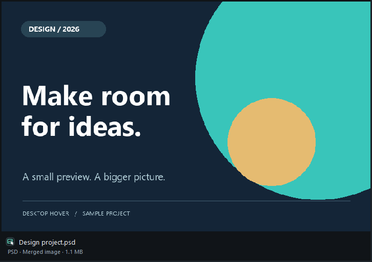
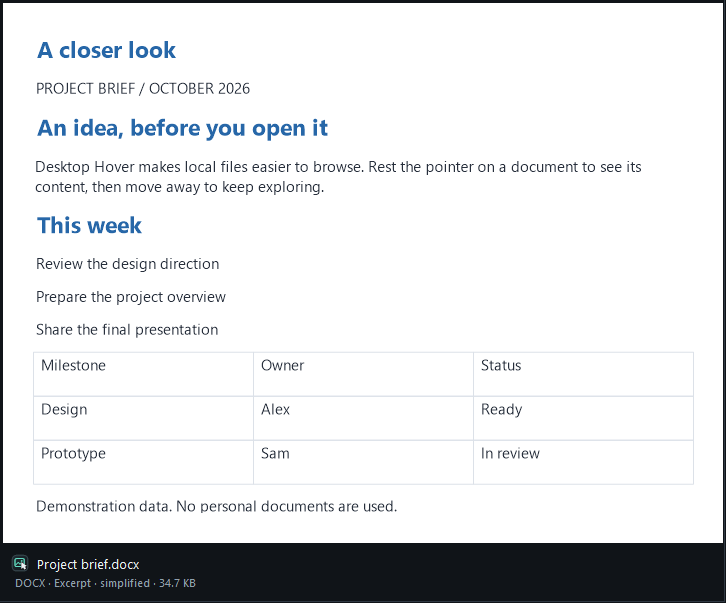
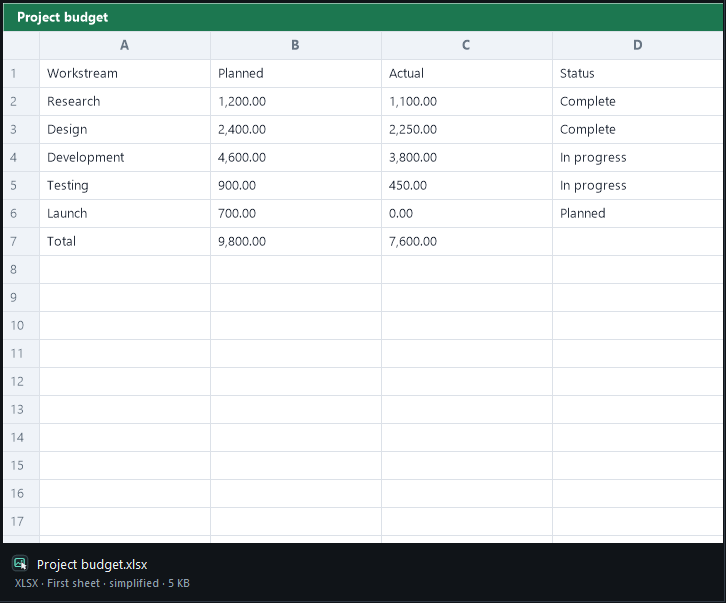
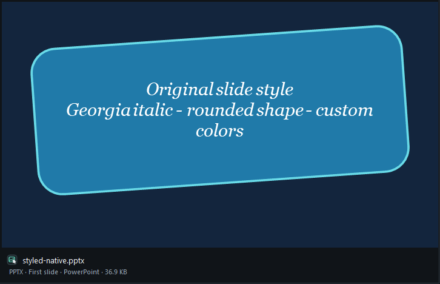
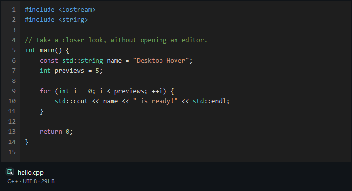
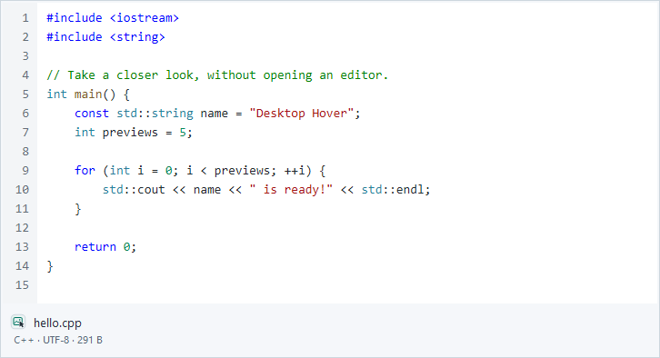
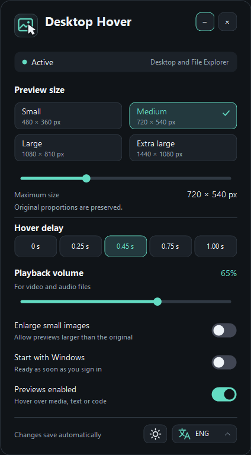
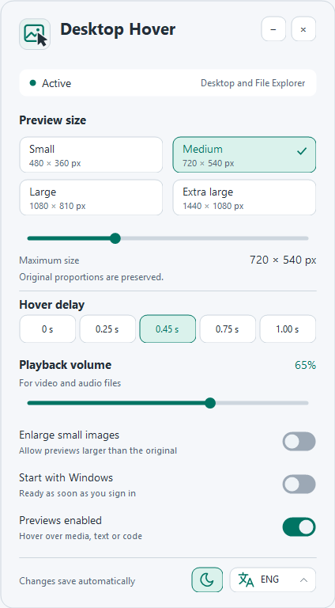
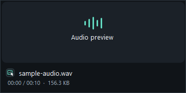
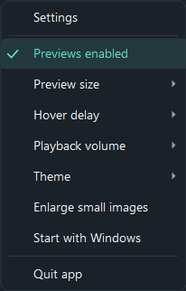

<p align="center">
  
</p>

<h1 align="center">Desktop Hover</h1>

<p align="center"><strong>A closer look. Just a hover away.</strong></p>
<p align="center">Preview images, documents and design projects, play media, and read code without opening another app.</p>

<p align="center">
  <strong>Windows x64</strong> &nbsp;·&nbsp; Desktop &amp; File Explorer &nbsp;·&nbsp; Dark &amp; light themes &nbsp;·&nbsp; 12 languages
</p>

<p align="center">
  <a href="#get-started">Get started</a> &nbsp;·&nbsp;
  <a href="#screenshots">Screenshots</a> &nbsp;·&nbsp;
  <a href="#supported-files">Supported files</a> &nbsp;·&nbsp;
  <a href="README.lv.md">Latviski</a>
</p>

---

Desktop Hover is a Windows tray app that previews a local file when you rest the pointer over it on the desktop or in File Explorer. See an image, listen to an audio clip, watch a video, or inspect a source file. Move away and the preview closes; media playback stops with it.

<p align="center">
  
</p>

## What you can do

| Feature | What it does |
| --- | --- |
| **See images at a glance** | A compact preview with the filename, dimensions and file size. Original proportions are preserved. |
| **Listen and watch** | Audio plays on hover. Video plays inside the preview with sound. One volume setting controls both. |
| **Read text and code** | Line numbers, a monospace font and syntax colors for common languages, scripts and configuration files. |
| **Look inside documents and projects** | PDF first pages, Word excerpts, Excel worksheets, PowerPoint slides, Photoshop composites and PDF-compatible Illustrator artwork. Other Adobe projects use embedded previews, matching image/video preview files or Windows thumbnails. |
| **Make it your own** | Dark or light appearance, 12 interface languages, adjustable preview size, hover delay and optional startup with Windows. |

## Screenshots

### Documents and design projects

These are real hover previews of demonstration files. Word and Excel content is simplified when a usable saved preview is absent. PowerPoint uses native or saved slide images to preserve the design. The footer identifies the preview type.

<table>
  <tr><th>Photoshop</th><th>Word</th></tr>
  <tr>
    <td></td>
    <td></td>
  </tr>
  <tr><th>Excel</th><th>PowerPoint</th></tr>
  <tr>
    <td></td>
    <td></td>
  </tr>
</table>

### Code, without launching an editor

The preview highlights keywords, strings, comments, numbers and other tokens. Its colors follow your chosen theme.



<details>
<summary>View the same code in the light theme</summary>



</details>

### One settings window. Two themes.

Change the appearance with the sun/moon button beside the language selector. Settings save automatically and take effect immediately.

<table>
  <tr><th>Dark theme</th><th>Light theme</th></tr>
  <tr>
    <td></td>
    <td></td>
  </tr>
</table>

<details>
<summary><strong>See the audio preview and tray menu</strong></summary>

| Audio preview | Quick settings |
| :---: | :---: |
|  |  |

</details>

*Screenshots are rendered from the application with sample files. The landscape illustration is a documentation sample.*

## Get started

### Run it without installing

1. Open [DesktopHover.exe](DesktopHover.exe) in this repository and use **Download raw file**, or download and extract the repository ZIP.
2. Put `DesktopHover.exe`, [LICENSE](LICENSE) and [THIRD-PARTY-NOTICES.md](THIRD-PARTY-NOTICES.md) in a folder you want to keep and run the executable.
3. Find its icon in the Windows system tray. It may be inside the **Show hidden icons** menu.
4. Hover over a supported local file on the desktop or in File Explorer.

**Requirements:** 64-bit Windows, the desktop .NET Framework 4.x runtime with Windows Forms/WPF, and Windows codecs for the media you want to preview. The build script uses the system Framework64 installation. macOS, Linux and third-party file managers are not supported.

### Optional per-user installation

Download or clone the whole repository, open PowerShell in its folder, then run:

```powershell
powershell -ExecutionPolicy Bypass -File .\Install.ps1 -OpenSettings
```

The script copies the app and documentation to `%LOCALAPPDATA%\DesktopHover` and opens Settings. **A first installation enables startup with Windows.** You can turn it off in Settings. Running the script again updates the installed copy while keeping your preferences.

## Everyday controls

While previews are enabled, DesktopHover temporarily deactivates Windows file infotips in the current Explorer or desktop file view, so they do not repeatedly appear over the preview. This also applies to unsupported files in that view. Leaving the view, pausing previews or quitting restores the controls; a small background helper restores them if the main process is forcibly stopped. Windows preferences and the Explorer Preview pane are unchanged. A first tooltip may briefly appear before its control is detected.

| Action | Result |
| --- | --- |
| Hover over a supported file | Show its preview after the selected delay. |
| Move off the file | Close the preview and stop playback. |
| Left-click the tray icon | Open Settings in the center of the pointer's monitor. |
| Right-click the tray icon | Open quick settings for previews, size, delay, volume, theme and startup. |
| Click **−** in Settings | Minimize Settings to the Windows taskbar. Click its taskbar button to restore it. |
| Click **×** in Settings | Close the settings window and keep Desktop Hover running in the system tray. |
| Choose **Quit app** in the tray menu | Quit Desktop Hover completely. |
| Switch off **Previews enabled** | Pause previews without closing the app. |

### Available settings

| Setting | Options |
| --- | --- |
| Preview size | 480 × 360, 720 × 540, 1080 × 810 or 1440 × 1080; a slider adjusts the maximum size. Content keeps its aspect ratio. |
| Hover delay | 0, 0.25, 0.45, 0.75 or 1.00 seconds. Zero removes the added wait; file detection and loading still take time. |
| Playback volume | 0–100% for audio and video. Set 0% to mute. |
| Appearance | Dark or light, including menus and code previews. |
| Enlarge small images | Allow an image smaller than the preview limit to be enlarged. |
| Start with Windows | Run automatically after you sign in. |

**Interface languages:** English · Latviešu · Русский · 简体中文 · Deutsch · Español · Français · Português (Brasil) · Italiano · 日本語 · 한국어 · Українська.

Preferences are stored in `%LOCALAPPDATA%\DesktopHover\settings.ini`. Startup is stored separately in the current user's Windows Run registry key.

## Supported files

| Kind | Recognized formats and examples |
| --- | --- |
| **Images** | JPG/JPEG/JFIF, PNG, BMP, GIF (including animation), TIFF, ICO, WebP, HEIC/HEIF, AVIF and Adobe DNG (requires a compatible Windows RAW decoder). |
| **Audio** | MP3, WAV, WMA, M4A, AAC, FLAC, AIF/AIFF. |
| **Video** | MP4/M4V, MOV, AVI, WMV, MPG/MPEG, MKV, WebM, FLV/F4V; playback requires a compatible Windows codec. |
| **Text & data** | TXT, LOG, CSV/TSV, Markdown, JSON, YAML, INI, TOML and other configuration files. |
| **Source code** | C/C++, C#, JavaScript/TypeScript, Python, Java, Go, Rust, Kotlin, Swift, PHP, Ruby, SQL, HTML/XML/CSS and related formats. |
| **Scripts & project files** | PowerShell, shell and batch scripts; Dockerfile, Makefile, CMakeLists.txt, README, LICENSE and common dotfiles. |
| **PDF** | The first page, rendered using the built-in Windows 10/11 PDF renderer. No Adobe application or Windows thumbnail provider is required. |
| **Photoshop** | PSD/PSB/PSDT merged 8-bit RGB/grayscale images with raw or RLE compression, fitted to the preview size. Saved thumbnails are a fallback. |
| **Word, Excel & PowerPoint** | DOCX, XLSX, PPTX and their macro-enabled/template variants; PPSX/PPSM presentations. Word/Excel use a saved preview, then a simplified excerpt or first visible worksheet. PowerPoint preserves styles using a sufficiently large saved image, native PowerPoint export or the best available saved/Windows thumbnail. |
| **Illustrator** | AI/AIT with PDF-compatible content render their first page at the selected size. EPS/EPSF/EPSI can use a saved TIFF or XMP preview, a matching preview file or a Windows thumbnail. PostScript is not executed. |
| **Adobe layout and motion projects** | INDD/INDT/INDB/IDML/INX, ICML/ICMT, XD, AEP/AEPX/AET/AETX, PRPROJ/PRTL, MOGRT/AEGRAPHIC, FLA/XFL/SWF and CHPROJ/PUPPET are recognized. **A supported embedded preview, matching image/video preview file or Windows thumbnail is required.** SWF content is not executed. |
| **Other Adobe projects** | Captivate CP/CPT/CPTX/CPTL, Audition SESX, Dimension DN and Substance SBS/SBSAR/SPP/SSA/ALCH/SSG/SMOD use supported saved previews, matching image/video preview files or Windows thumbnails. Proprietary project scenes and timelines are not rendered. |
| **Other documents** | Legacy DOC/XLS/PPT and templates, and XLSB depend on a Windows thumbnail provider. ODT/ODS/ODP can also use their saved PNG thumbnail. |

File extensions identify preview candidates; **actual image decoding and media playback depend on the Windows codecs installed on your machine**. See [MediaFiles.cs](src/Preview/MediaFiles.cs), [TextPreviewContent.cs](src/Preview/TextPreviewContent.cs), [AdobeProjectFiles.cs](src/Preview/Documents/AdobeProjectFiles.cs) and [DocumentPreviewContent.cs](src/Preview/Documents/DocumentPreviewContent.cs) for the full extension lists.

Document previews load in the background and are canceled when you move away. The built-in readers work without Office or Adobe applications; higher-resolution native PowerPoint export requires the installed desktop PowerPoint application. Windows thumbnail support depends on the handlers installed on your computer; if no usable preview exists, the app shows an explanation.

Supported Photoshop composites and native PowerPoint exports fill the configured preview bounds while keeping their proportions, without enabling **Enlarge small images**. PowerPoint themes, fonts, backgrounds and shapes come from an actual slide image; slides are never reconstructed from partial XML content. If only a small saved thumbnail can be read, enlarging it cannot recover missing detail.

Native PowerPoint export handles static PPTX/POTX/PPSX packages when PowerPoint is installed and idle. It opens a temporary read-only copy without a visible window, disables macros, and skips packages containing linked media or active content. If PowerPoint is already open, a saved/Windows preview is used without attaching to that session. The last successful native preview is cached until the file or requested size changes.

PDF rendering runs in a separate helper with a time limit. Leaving the file cancels the preview and stops its helper, keeping the app responsive when a PDF cannot be rendered.

### Adobe image and video previews

Illustrator artwork saved with **Create PDF Compatible File** can be rendered directly. Other Adobe readers look for explicitly named PNG/JPEG previews and XMP thumbnails, including ZIP metadata and bounded gzip-compressed Premiere project metadata. The largest usable saved image is selected. EPS files with a DOS binary header can use their embedded TIFF preview.

For a project without a usable embedded preview, export an image or video into the same folder with `.preview` in its name. For example, `Campaign.aep` can use `Campaign.preview.mp4` or `Campaign.preview.png`. `Campaign.aep.preview.mp4` also works and takes priority over the shorter name. These deliberately named preview files take priority over embedded previews; source footage linked inside the project is not played as a substitute for the finished composition.

Preview files support MP4/MOV/WebM/M4V/AVI/WMV video and PNG/JPG/JPEG/WebP/BMP images. Video follows the normal volume setting and stops when the pointer leaves the project. The footer keeps the project's filename and marks the content as a **Preview file**. Export the preview again after changing the project. Images are limited to 64 MiB and 40 million pixels; videos to 512 MiB. A larger project can still use a preview file because its project contents are not parsed.

### Current limits

- Previews work with **locally available files**. Network shares, mapped network drives and online-only cloud files are skipped.
- Text previews read up to **256 KiB**, **300 lines** and **500 characters per line**. Only the beginning that fits in the preview is visible; shortened previews are marked in the footer.
- Syntax coloring is a basic lexer, not a full language service. Code is displayed without being executed or edited.
- Markdown, HTML and SVG are shown as source text, rather than rendered documents.
- Document/project parsing is limited to **512 MiB** per file; Adobe preview files have the separate limits above. ZIP packages also have limits on entries, XML and embedded images; encrypted, malformed or oversized content may be unavailable.
- PDFs show **the first page only**, fitted to the configured preview size. Page navigation, editing and password entry are not provided. Files that require a password, damaged PDFs and unsupported content may not preview.
- Word and Excel content previews are excerpts, not exact print layouts. Excel shows cached values or formula text; formulas and macros are never run, and external links are not loaded. Only the first visible worksheet's beginning (up to 8 columns/30 rows) is considered. PowerPoint previews show the first slide as a still image; animations and navigation are not provided. Native export has a 12-second limit and falls back to saved/Windows previews when unavailable.
- Photoshop merged-image decoding is limited to **40 million pixels**, 8-bit RGB/grayscale and raw/RLE compression. Other color modes, depths and ZIP compression require a saved or Windows thumbnail. Layers are not reconstructed and color profiles are not applied. Adobe project recognition does not guarantee an embedded image exists. After Effects/Premiere timelines, Animate animations, 3D scenes and other proprietary projects need a saved preview or an exported preview file; full project rendering is not provided.
- Saved previews and Windows thumbnails can reflect an earlier saved state. Their resolution depends on the source; saving the project with its preview enabled can help.
- Animated GIFs play automatically while hovering, using their frame delays and repeat settings. Moving within the same file's icon keeps the animation playing; leaving the file stops it. Other animated or multi-frame image formats show a still frame.
- Images over **100 MiB** or **100 million pixels** are skipped. GIFs also have a limit of **2,000 frames** and **100 million pixels summed across frame rectangles**. Missing or very short GIF delays (0–10 ms) use 100 ms.
- Previews are passive: they do not take keyboard focus or provide an editor or interactive playback controls.

## Build from source

The app uses C#, Windows Forms for its interface, WPF for media playback and image decoding, and Windows Shell/UI Automation to identify hovered files. It has no NuGet package restore step or `.sln`/`.csproj` build entry point.

Build on Windows 10/11 with .NET Framework 4.8. PDF support references the operating system's `System32\WinMetadata` files and the framework's `System.Runtime.dll` / `System.Runtime.WindowsRuntime.dll`; no Windows SDK installation is needed.

```powershell
git clone https://github.com/LaxZo/DesktopHover.git
cd DesktopHover
powershell -ExecutionPolicy Bypass -File .\build.ps1
.\DesktopHover.exe --settings
```

`build.ps1` delegates to [scripts/build.ps1](scripts/build.ps1), which invokes the 64-bit .NET Framework C# compiler:

```text
C:\Windows\Microsoft.NET\Framework64\v4.0.30319\csc.exe
```

Stop a running copy before replacing its executable, or build to a separate location with `-OutputPath`.

### Repository layout

```text
DesktopHover/
├── src/
│   ├── App/                 # Entry point, preferences and translations
│   ├── UI/                  # Settings, tray menu and visual style
│   ├── Preview/             # Preview window, images, media and text
│   │   └── Documents/       # PDF/Office/Adobe readers and archive validation
│   └── Windows/             # Explorer integration and document workers
├── assets/                  # Application icon and README logo
├── scripts/                 # Build and installation implementations
├── docs/assets/             # Screenshots and their provenance
├── DesktopHover.exe         # Portable application
├── build.ps1                # Shortcut to scripts/build.ps1
├── Install.ps1              # Shortcut to scripts/Install.ps1
├── README.md
└── README.lv.md
```

Start with `src/App/Program.cs` for the application lifecycle or `src/Preview/PreviewWindow.cs` for previews. The build includes C# files under `src` and embeds `assets/DesktopHover.ico`. The root scripts preserve the commands shown above; generated verification files and local Graphify data are ignored by Git.

<details>
<summary><strong>Source map and useful launch options</strong></summary>

| File | Responsibility |
| --- | --- |
| [scripts/build.ps1](scripts/build.ps1), [scripts/Install.ps1](scripts/Install.ps1) | Build and installation; the root scripts forward their parameters here. |
| [Program.cs](src/App/Program.cs) | App lifecycle, tray icon, hover timing and startup registration. |
| [ShellResolver.cs](src/Windows/ShellResolver.cs) | Resolve the file beneath the pointer in Explorer or on the desktop. |
| [ShellInfoTipSuppressor.cs](src/Windows/ShellInfoTipSuppressor.cs), [InfoTipRestoreGuard.cs](src/Windows/InfoTipRestoreGuard.cs) | Temporarily deactivate Explorer file infotips and restore them on pause/exit or unexpected termination. |
| [PreviewWindow.cs](src/Preview/PreviewWindow.cs) | Preview layout, rendering and content switching. |
| [AnimatedGif.cs](src/Preview/AnimatedGif.cs) | GIF frame timing, repeat settings, bounded loading and native frame compositing. |
| [MediaPlayback.cs](src/Preview/MediaPlayback.cs) | Audio/video playback using Windows media support. |
| [TextPreviewContent.cs](src/Preview/TextPreviewContent.cs) | Bounded text loading, encoding detection and syntax tokens. |
| [DocumentPreviewContent.cs](src/Preview/Documents/DocumentPreviewContent.cs), [DocumentArchiveGuard.cs](src/Preview/Documents/DocumentArchiveGuard.cs) | Document routing, limits and bounded ZIP validation. |
| [OfficePreviewReader.cs](src/Preview/Documents/OfficePreviewReader.cs), [AdobePreviewReader.cs](src/Preview/Documents/AdobePreviewReader.cs) | Local document content and embedded project-image readers. |
| [PdfPreviewReader.cs](src/Preview/Documents/PdfPreviewReader.cs) | Render the first PDF page with Windows.Data.Pdf. |
| [DocumentPreviewWorker.cs](src/Windows/DocumentPreviewWorker.cs) | Shared PDF/PowerPoint/thumbnail helper process with cancellation, timeout and output limits. |
| [PowerPointPreviewReader.cs](src/Preview/Documents/PowerPointPreviewReader.cs) | Native slide export, style-preserving fallback and cache. |
| [ShellThumbnailProvider.cs](src/Windows/ShellThumbnailProvider.cs) | Windows thumbnail fallback through the shared document worker. |
| [SettingsWindow.cs](src/UI/SettingsWindow.cs), [TrayMenu.cs](src/UI/TrayMenu.cs) | Settings window and quick menu. |
| [Brand.cs](src/UI/Brand.cs), [Localization.cs](src/App/Localization.cs) | Theme palettes, icons and translations. |
| [AppSettings.cs](src/App/AppSettings.cs) | Preference validation and persistence. |

```powershell
.\DesktopHover.exe --settings
.\DesktopHover.exe --enable-startup
.\DesktopHover.exe --disable-startup
```

The startup options register or remove the path of the executable you run. Use the installed copy if that is the one you normally use. Starting a second copy opens the existing app's Settings window.

</details>

## Troubleshooting

| Problem | What to check |
| --- | --- |
| Nothing happens when hovering | Confirm the app is running, previews are enabled, and the file is local and supported. Use the Windows desktop or File Explorer. |
| A cloud file does not preview | Make it available offline first. Hovering does not download online-only files. |
| Audio or video will not play | Check the volume and the file's codec support in Windows. A recognized extension alone does not guarantee decoding. |
| Text is cut off | Large files and long lines are intentionally shortened. Open the file in an editor to read the rest. |
| A PDF has no preview | Confirm it is a local file no larger than 512 MiB and can be opened without a password. Damaged or unsupported PDFs may be unavailable; no Adobe installation is needed. |
| An Adobe project has no preview | Save Illustrator with PDF compatibility, enable saved preview images in InDesign, or export a matching `.preview.png`/`.preview.mp4` beside the project. See Adobe image and video previews above. |
| An older Office file has no preview | Save it with an embedded preview, or use a compatible Windows thumbnail handler. Recognizing the extension does not guarantee content can be decoded. |
| A document looks different from the editor | The footer marks simplified content. Open the original application for complete formatting, all pages, worksheets and slides. |
| Settings is minimized | Restore it from the Windows taskbar or left-click the tray icon. |
| The app still runs after clicking **×** | This closes Settings and keeps previews running. Right-click the tray icon and choose **Quit app** to quit completely. |

To remove an installed copy, switch off **Start with Windows**, quit the app, and delete `%LOCALAPPDATA%\DesktopHover`. Deleting that folder also removes its saved preferences.

## Feedback and contributions

[Report a bug or suggest a feature](https://github.com/LaxZo/DesktopHover/issues). For a preview issue, include your Windows version, file type, selected settings and steps to reproduce it. A small non-sensitive sample file helps.

Contributions are welcome. Describe the behavior you changed, build with `build.ps1`, and include screenshots for interface changes.

## License

Desktop Hover is licensed under the [MIT License](LICENSE). Copyright © 2026 LaxZo.

You may use, modify and redistribute it, including commercially and in closed-source projects, provided you retain the copyright and license notices. The software is provided without warranty. Include `LICENSE` and [THIRD-PARTY-NOTICES.md](THIRD-PARTY-NOTICES.md) when sharing the source code or executable; the installer copies them alongside the app. The GitHub button uses an MIT-licensed GitHub Octicons logo.
